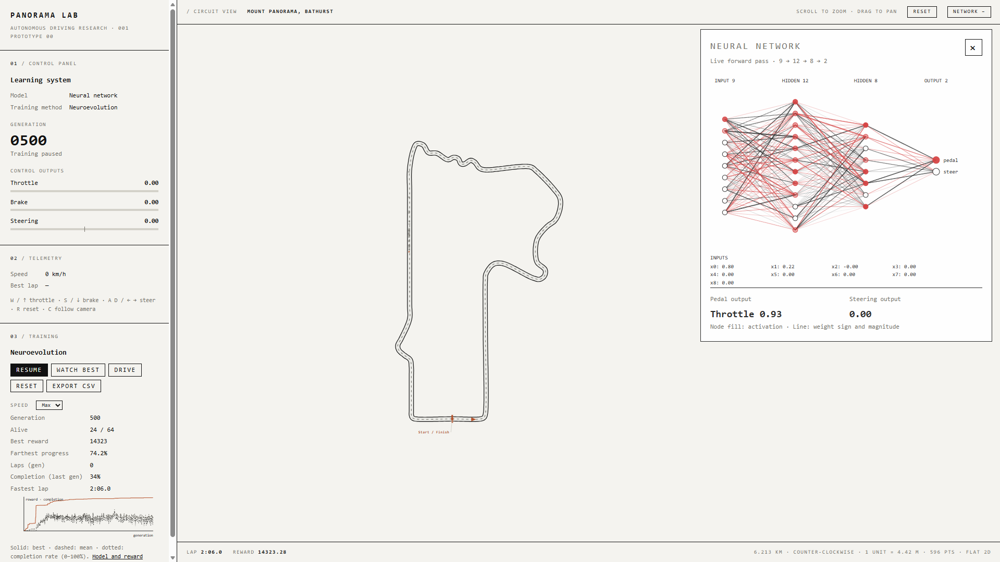

# ML Track Trainer

A browser-based driving lab for any circuit. Drive manually or train a neural network to complete a lap using neuroevolution. The project includes a custom track editor, car physics, training visualisation and CSV analysis tools.

Ships with Mount Panorama (Bathurst) as the example track. Part of [project name].




## Run

Open `index.html` in a browser.

The simulator runs without a build step or external JavaScript dependencies.

## Controls

| Key | Action |
|---|---|
| W / ↑ | Throttle |
| S / ↓ | Brake |
| A / D / ← / → | Steer |
| R | Reset car |
| C | Follow camera |

Scroll to zoom and drag to pan.

## Modes

- **Drive:** Control the car manually.
- **Train:** A population of 64 neural networks drives the circuit. Better-performing networks are retained, mutated and recombined across generations.
- **Watch best:** Watch the saved best network drive. Models are saved per track name in browser `localStorage`.

## How it works

Each network receives nine inputs:

- Speed
- Lateral offset
- Heading error
- Five look-ahead track angles
- Current steering

The network outputs a signed pedal value and steering command. Positive pedal output applies throttle; negative output applies braking.

Training uses neuroevolution to optimise cumulative reward. The reward encourages forward progress and lap completion while penalising time, grass and wall contact.

See `model.html` for the network architecture, observations, reward function, evolution settings and limitations.

## Training data and graph generation

`training.csv` stores driver-level training results, including:

- Run ID, random seed, generation and driver ID
- Total reward and termination reason
- Lap completion, lap time and progress
- Elapsed time and off-road duration
- Reward contributions from progress, time, grass and terminal events

The `plot_training_csv.py` script reads this CSV and generates minimalist PNG graphs using an off-white, charcoal and red palette.

### Requirements

Python 3 and the following packages:

```bash
python -m pip install pandas matplotlib
```

These packages are only required for graph generation, not for running the browser simulator.

### Generate graphs

Generate the full set of supported graphs:

```bash
python plot_training_csv.py training.csv --all
```

The script creates a `graphs/` directory containing:

| Graph | What it shows |
|---|---|
| `reward.png` | Driver rewards and, when multiple generations are available, best and mean reward by generation |
| `progress_pct.png` | Progress through the lap |
| `elapsed_s.png` | Episode duration |
| `lap_time_s.png` | Completed lap times, where available |
| `offroad_s.png` | Time spent off-road |
| `termination.png` | Counts of wall contacts, stalls, timeouts, lap completions and other termination reasons |
| `completion.png` | Completed versus unfinished laps |
| `reward_components.png` | Mean reward contributions from progress, time, grass and terminal events |

Missing or blank values, such as lap times for unfinished laps, are excluded from numeric plots.

### Generate an individual graph

```bash
python plot_training_csv.py training.csv --metric reward
python plot_training_csv.py training.csv --metric termination
python plot_training_csv.py training.csv --metric completion
python plot_training_csv.py training.csv --metric reward_components
```

Group a numeric metric by generation:

```bash
python plot_training_csv.py training.csv --metric progress_pct --group generation
```

List the available numeric metrics:

```bash
python plot_training_csv.py training.csv --list-metrics
```

Choose a different output directory:

```bash
python plot_training_csv.py training.csv --all --output-dir results/graphs
```

The graphs describe the data recorded in the CSV. They do not automatically record new training sessions or prove that performance improvements generalise to independent runs.

## Use your own track

1. Open `trace.html` and load an image of the circuit.
2. Click the track centreline in driving direction.
3. Copy the generated points.
4. In `track.js`, paste the points into `CONTROL`.
5. Set `NAME` and `LAP_METERS` to the track name and real lap length.
6. Adjust `WIDTH_FACTOR` until the road width looks correct.
7. Optionally label corners in `CORNER_INDEX`.

Models are saved per track name. Changing `NAME` creates a separate model entry; use the simulator's reset functionality when you want to clear the saved best model for the current track.

## Tuning

| Setting | File | Purpose |
|---|---|---|
| Reward function | `env.js` | Progress, time, grass, terminal penalties and bonuses |
| Car physics | `env.js` | Vehicle dynamics and handling |
| Network architecture | `brain.js` | Neural network layer sizes |
| Evolution settings | `brain.js` | Population, selection, crossover and mutation |
| Track geometry | `track.js` | Centreline, road width, length and corner labels |
| Visual appearance | `style.css` | Interface styling |

## Project files

| File | Purpose |
|---|---|
| `index.html` | Main simulator interface |
| `style.css` | Layout, controls, dashboard and visual styling |
| `track.js` | Track data and geometry |
| `env.js` | Car physics, observations, reward and episode termination |
| `brain.js` | Neural network and neuroevolution |
| `sim.js` | Manual driving controls |
| `trainer.js` | Training loop, population management and training readouts |
| `app.js` | Circuit rendering, pan/zoom and interface readouts |
| `network-view.js` | Neural network visualisation |
| `model.html` | Model documentation and training details |
| `trace.html` | Track centreline tracing tool |
| `plot_training_csv.py` | CSV analysis and PNG graph generation |
| `training.csv` | Recorded driver-level training data |
| `graphs/` | Generated graph images |

## Limitations

- The car and circuit use a simplified 2D physics model rather than a full racing simulator.
- The network uses track-relative observations rather than camera images or raycasting.
- Neuroevolution optimises the configured reward; it does not guarantee realistic racing behaviour or generalisation to other circuits.
- Results depend on the track geometry, reward settings and random initialisation.
- Graph quality and conclusions depend on the quantity and completeness of recorded training data.

## Licence

MIT